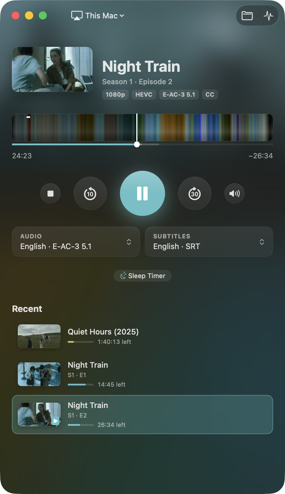
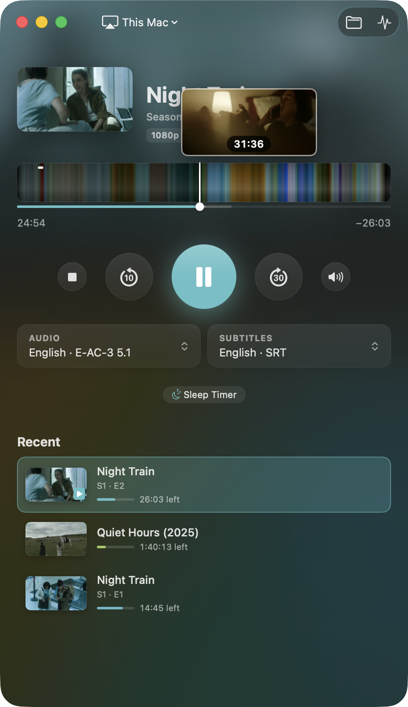
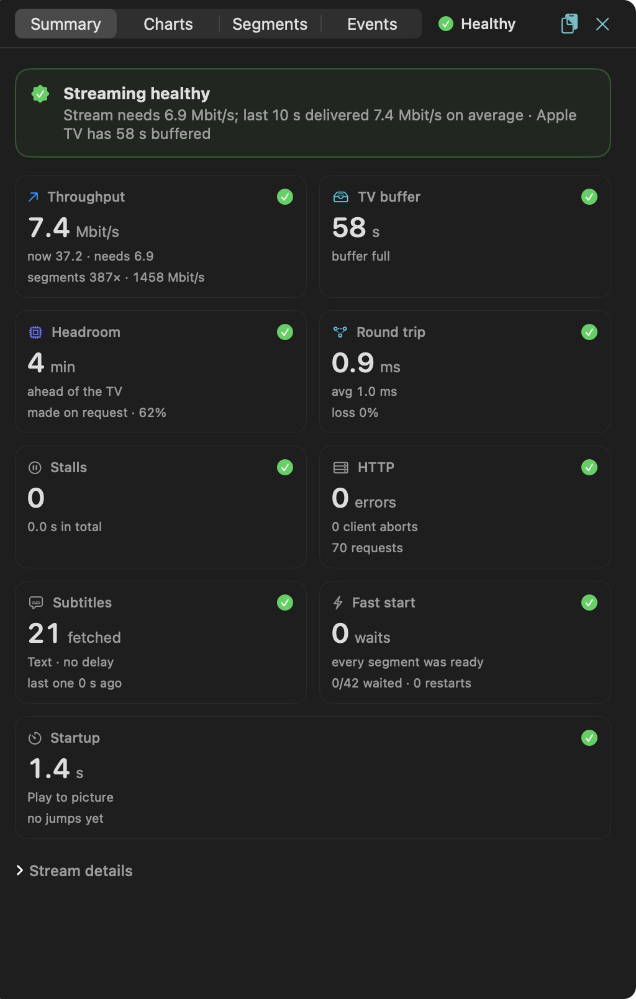
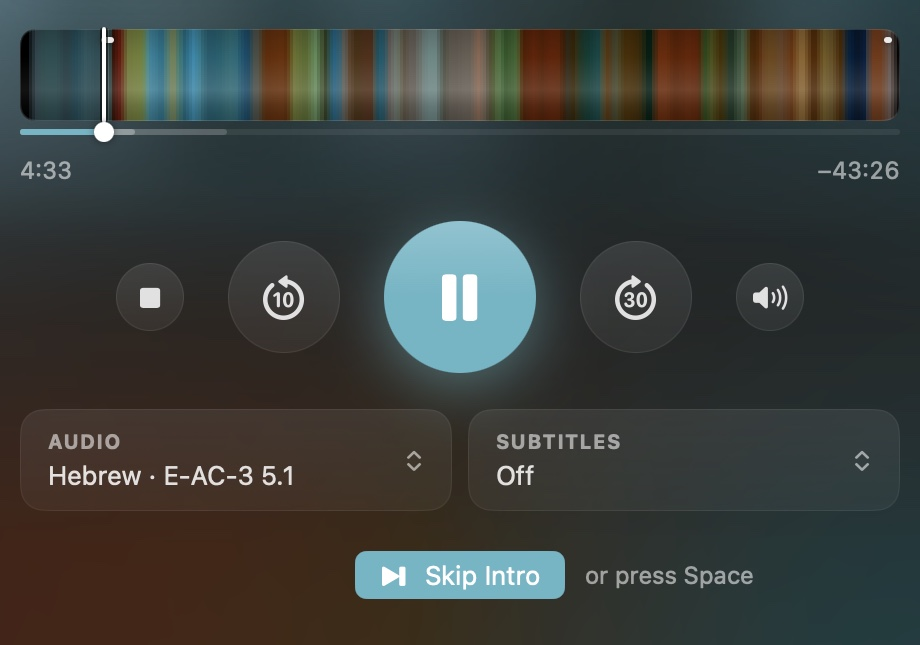
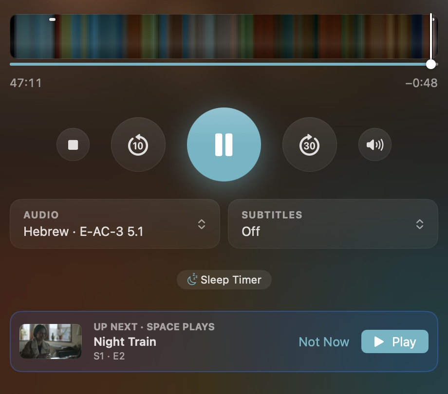
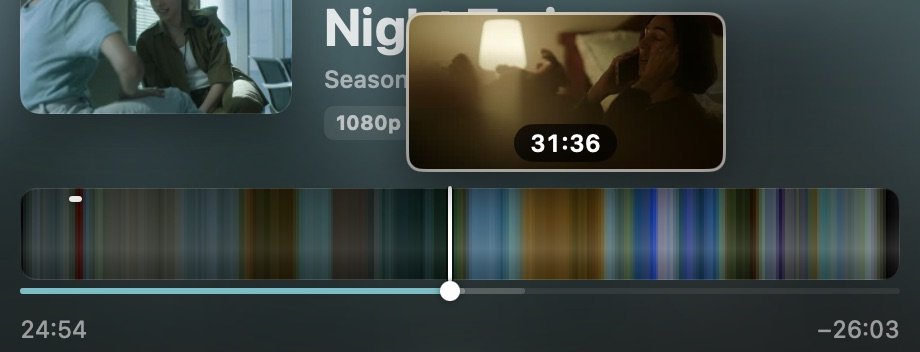
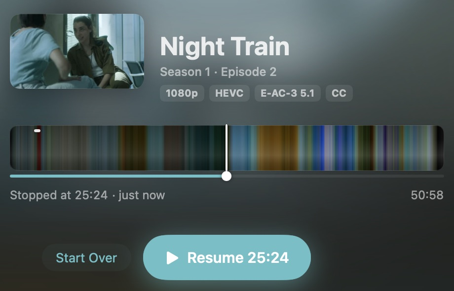
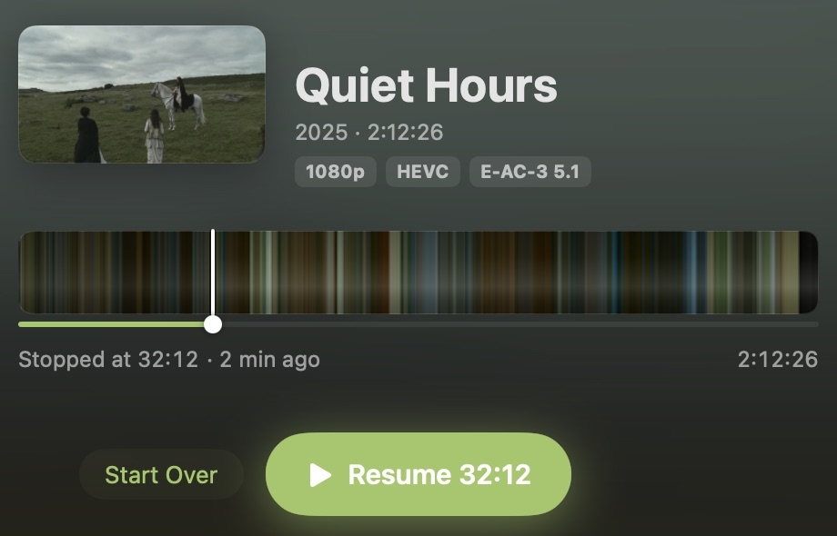
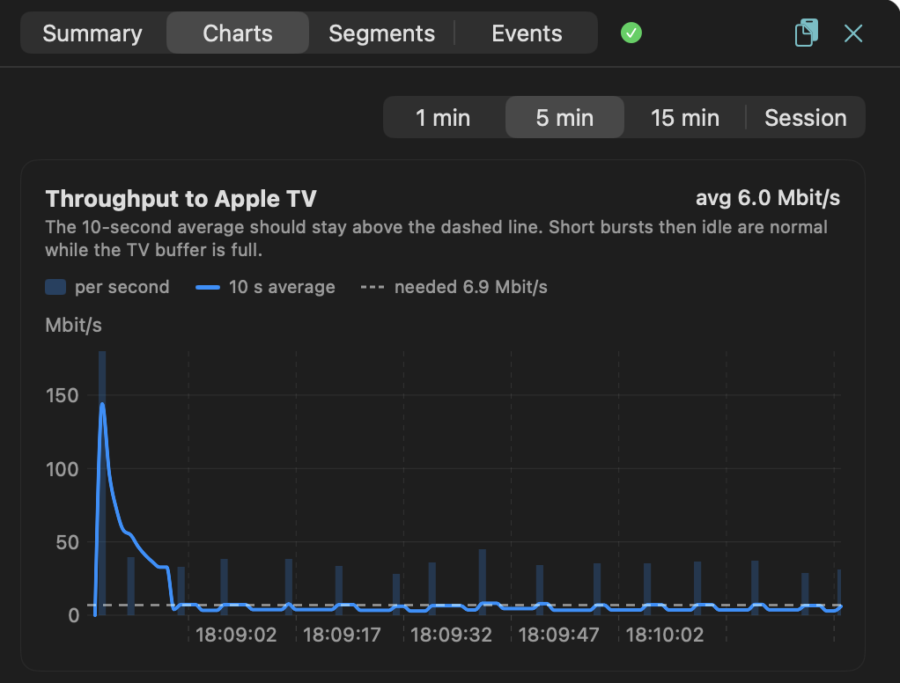

<p align="center">
  
</p>

<h1 align="center">Luftbro</h1>

<p align="center">
  Your own films and series on the Apple TV, straight from the Mac.
</p>

<p align="center">
  <a href="https://github.com/luftbro/luftbro/releases/latest">Download</a> ·
  <a href="https://luftbro.github.io/luftbro/">Website</a> ·
  <a href="docs/using.md">Using it</a> ·
  <a href="docs/how-it-works.md">How it works</a> ·
  <a href="docs/troubleshooting.md">Troubleshooting</a>
</p>

<p align="center">
  
  
  
</p>

Luftbro is a small Mac app that plays your own video files on an Apple TV over
AirPlay. There's no media server, no library to set up and nothing to convert
first. Drop a file on the window, press Play, and it's on the TV in about a
second. The Mac is the remote.

I have a folder of films and series and an Apple TV that won't open half of them. The
usual answer is a media server, which is a lot of machinery between a file and
a Play button. So I wrote the part in between, plus the things I kept wanting
while watching.

## What it does

### On the TV in about a second

Drop a film or an episode on the window and press Play, and about a second later
it's playing on the Apple TV. The picture and sound are copied as they are, so 4K
HDR, Dolby Vision and Atmos reach the TV untouched. MKV, MP4 and MOV start that
fast, including the files the Apple TV won't open on its own. AVI, MPG, MTS, WMV
and most other formats play after a short wait while the start is
prepared, and a file that is still downloading plays too. Only what the Apple TV
can't play is converted, while you watch.

### Skip Intro, even without chapters

Skip Intro and Next Episode buttons, like on the streaming services. When the
file has chapters for the intro and the credits, Luftbro uses them. When it
doesn't, it finds the intro by matching its sound against the neighbouring
episodes, where the same theme plays, and the credits by spotting white text on
black near the end. Space presses the button for its first few seconds. The
episode in the pictures has no chapters, so its intro and credits were found
this way.

<p align="center">
  
  
</p>

### Subtitles synced to the speech

A subtitle file made for another release of the film often runs a few seconds
early or late all the way through, or drifts further off as the film goes on
because that release ran at another frame rate. **Subtitles → Delay → Sync
Automatically** listens to a few minutes of the audio with the sound classifier
built into macOS and moves the subtitles to where people are talking ("Subtitles
moved 2.4 s later"). Subtitles that drift get stretched to fit from start to
finish ("Subtitles stretched 4.3 % to fit, made for 25 fps"). If it isn't sure,
it leaves them as they were and says so. H and J nudge them by half a second if you'd rather do it by hand.

### A timeline in the film's colours

The timeline is the whole film drawn in its own colours, with a frame from that
point when you hover it. Mostly it looks nice, but you can also see the night
scenes before you jump to one. Thin marks along the top edge show where the
intro and the credits are.

<p align="center">
  
</p>

### Every film looks a little different

The window takes its colours from what's playing. The background is a blurred
frame from the film, and the progress bar and the Resume button take its most
vivid colour. The picture next to the title is the file's cover art; without
one, Luftbro reads the opening titles with the OCR built into macOS and shows
the title card, and failing that the best-looking frame.

<p align="center">
  
  
</p>

### When it stalls, it says why

A stall with no explanation is the worst part of watching anything. Diagnostics
names the likely cause (the network, the encoder, the Apple TV, the file or
Luftbro's own server) with the evidence: throughput, the TV's buffer and the
round trip over time, and every piece of the stream the TV asked for. It
records all the time, so you can open it after the fact. If the Wi-Fi drops,
Luftbro reconnects and carries on from where the TV was.

<p align="center">
  
</p>

### The Mac is the remote

Keyboard, media keys, Control Center, AirPods, the TV's volume, a sleep timer
and the Touch Bar if you still have one. With no TV around, *This Mac* plays in
a window on the Mac instead, with its own picture and sound controls.

### No account, no analytics

No subscription either. The stream goes from your Mac to your Apple TV over
your own network, and nothing about you or what you watch goes anywhere else.
The one other request is a daily look at GitHub for a newer version, which you
can turn off.

### Also

- Text subtitles (SRT, ASS, WebVTT) inside the file or next to it, `Subs/`
  folders included. Blu-ray PGS subtitles are read as text with the OCR built
  into macOS.
- A series remembers your audio, subtitles and subtitle timing from one episode
  to the next. When an episode ends, the next one is loaded ready to play, but
  it never starts by itself.
- Resume or Start Over, and a list of recent files with how far you got.
- Playback can move to another Apple TV in the middle of a film, and the Mac
  stays awake while it streams.

More in [Using Luftbro](docs/using.md).

## Install

You need a Mac with Apple Silicon (M1 or later) on macOS 14 or later, and an
Apple TV on the same network. I've tested it with tvOS 26. Without a TV it
plays on the Mac. On an Intel Mac you can [build it yourself](docs/building.md).

Download `Luftbro-1.0.1.dmg` from the
[latest release](https://github.com/luftbro/luftbro/releases/latest), open it
and drag Luftbro to Applications. Python and ffmpeg are inside the app, so
there's nothing else to install.

Luftbro isn't notarized by Apple, so macOS won't open it the first time:

1. Open Luftbro. macOS says it can't verify it. Click **Done**.
2. Open System Settings → Privacy & Security and scroll down. The message about
   Luftbro only shows up after that first try, for about an hour. Click
   **Open Anyway** and confirm with your password or Touch ID.
3. Click **Open Anyway** once more. From then on it opens like any app.

Or skip all that by running this once in Terminal:

```sh
xattr -dr com.apple.quarantine /Applications/Luftbro.app
```

The warning doesn't mean anything was found in the app, only that it isn't
signed by a paid Apple developer account.
[Here's why, and how to check it yourself](docs/how-it-works.md#why-macos-warns-about-it).

Then pick your Apple TV in the menu at the top left. The first time you play to
it, the TV shows a PIN to type into Luftbro. macOS asks whether to accept
incoming network connections; allow them, because the Apple TV fetches the
stream from your Mac.

Luftbro checks GitHub for a newer version once a day and tells you when there
is one. Nothing installs until you click Install.

## More

- [Using Luftbro](docs/using.md): keyboard shortcuts, the timeline, audio and
  subtitles, This Mac, Diagnostics and updates.
- [How it works](docs/how-it-works.md): the streaming, what gets converted, the
  colour timeline, and what leaves your Mac.
- [Troubleshooting](docs/troubleshooting.md) and known limitations.
- [Building from source](docs/building.md), the command line and development.
  [`docs/DESIGN.md`](docs/DESIGN.md) and [`docs/API.md`](docs/API.md) go into
  the app and its backend in detail.

The name is Swedish for *air bridge* (say it *LOOFT-broo*): a bridge through the
air from the Mac to the TV, and a nod to AirPlay, which carries it.

## Licence and credits

Luftbro is MIT-licensed, see [`LICENSE`](LICENSE). It uses
[pyatv](https://pyatv.dev) to talk to the Apple TV and
[FFmpeg](https://ffmpeg.org) for the video work. The download includes both
(FFmpeg built from its source as LGPL); a build from source uses your own.
[`THIRD_PARTY_NOTICES.md`](THIRD_PARTY_NOTICES.md) lists every dependency and
its licence, with notes on the icon and the screenshots. The colour timeline
is an idea borrowed from [@movieluts](https://www.instagram.com/movieluts/).

Apple, Apple TV, AirPlay, macOS and tvOS are trademarks of Apple Inc. Luftbro is
an independent project, not affiliated with or endorsed by Apple. Use it with
video you have the right to play.
