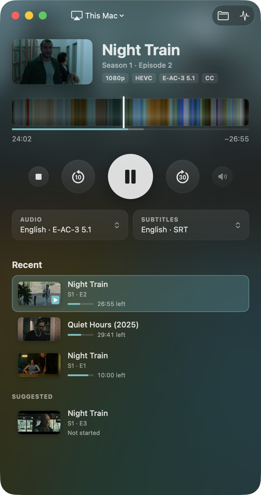
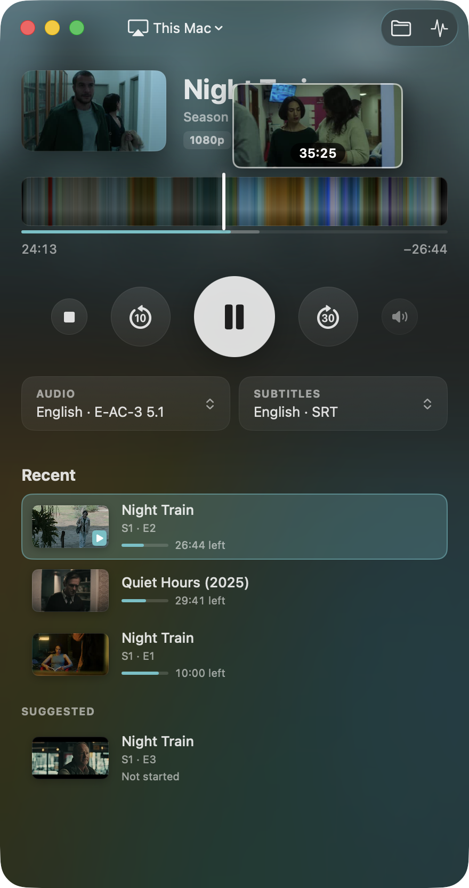
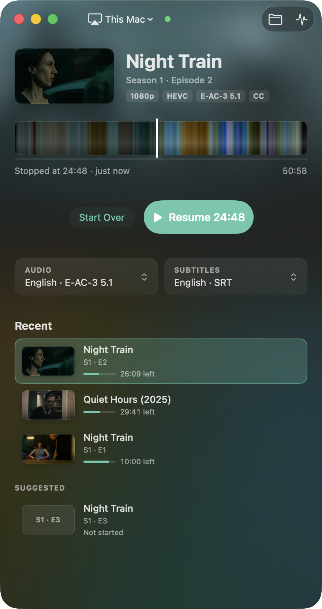
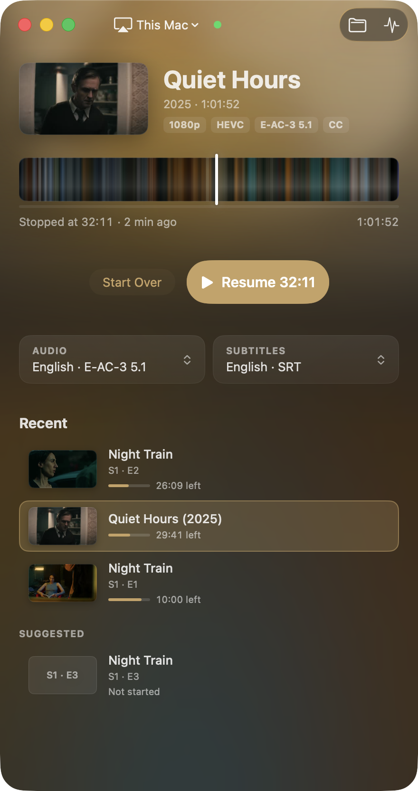
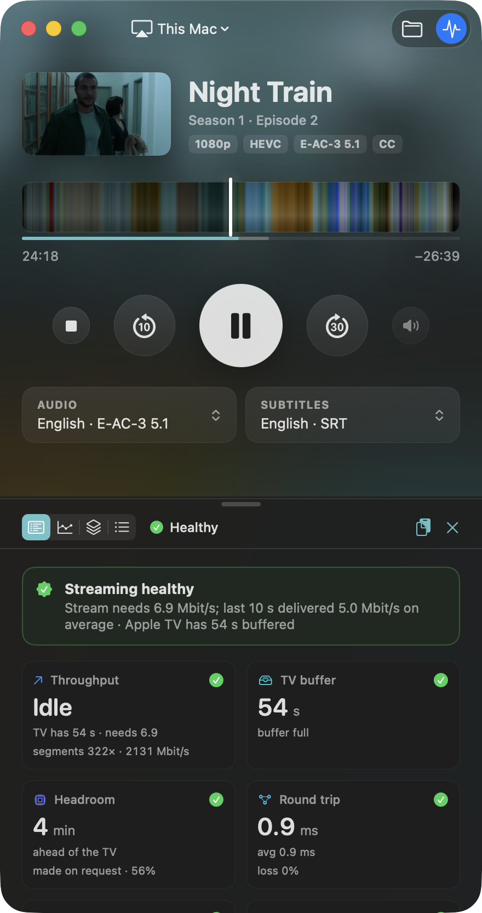
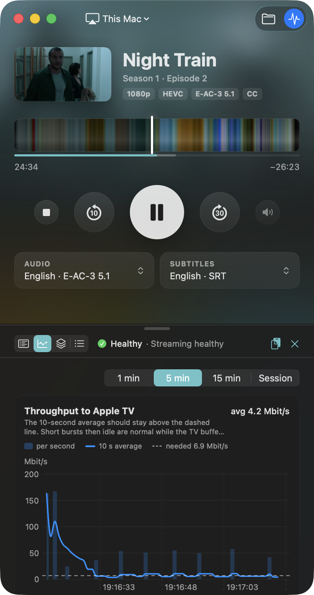

# Jancast

A Mac app for playing your own video files, MKV included, on an Apple TV. You
pick the audio track and subtitles, and the Mac app is the remote. If a stream
stutters or fails, the Diagnostics drawer shows what went wrong.

The timeline is the film drawn as stripes of colour, one per 10 seconds, an idea
taken from [@movieluts](https://www.instagram.com/movieluts/) on Instagram. More
about it [below](#the-colour-timeline).

<p align="center">
  
  
  
</p>
<p align="center">
  
  
  
</p>
<p align="center"><sub>Playing, hovering the timeline, ready to resume. Below, another film
gets its own timeline, background and accent colour; then the Diagnostics summary and
charts.</sub></p>

## Features

- MKV and other files the Apple TV can't open are converted to a stream it can
  play while you watch. H.264/HEVC video and AAC/AC-3/E-AC-3 (Atmos) audio are
  copied as they are, so quality is untouched and playback starts in about a
  second. Files that are still downloading (`movie.mkv.part`) play too, and
  Jancast follows the file when the download finishes.
- Audio and subtitles can be changed while playing. Text subtitles (SRT, ASS,
  WebVTT, and `.srt` files next to the video or in a subfolder like `Eng/` or
  `Subs/`, also named by language only as in `Subs/English.srt` or
  `Subs/SDH.eng.srt`) work, and so do Blu-ray picture subtitles (PGS), which are read as
  text with the OCR built into macOS. Subtitles can be shifted in half-second
  steps if they're out of sync.
- The main window shows what's playing and its format, a timeline made from the
  film's colours with a frame preview when you hover it, Up Next for series, and
  recent files to resume. The background and accent colour come from the film
  too (see [The colour timeline](#the-colour-timeline)).
- TV volume from the Mac (⌘↑ / ⌘↓, or the Mac's volume keys if you turn that on),
  media keys and Control Center. You can move playback to another Apple TV
  mid-film.
- A "This Mac" player, for when there's no TV.
- Diagnostics: a summary with the likely cause (network, encoder, Apple TV,
  source file, server), live charts, every segment request and an event log.
  It records all the time, so you can open it after something went wrong.

## The colour timeline

When a file opens, Jancast grabs a small frame every 10 seconds (keyframes only,
so a 45-minute episode takes a few seconds) and picks one colour for each frame.
Colourful pixels count for more than grey ones, so a scene keeps its hue instead
of averaging out to brown, and each colour is blended with its neighbours so
scenes show up as bands. Side by side, those colours are the timeline: you can
see the dark stretches, the daylight and the changes of scene before you jump.
The part you've watched is dimmed, and hovering shows the frame at that point.

The same frames set the window's look. The background is a blurred frame from
the film, with the current scene softly behind the title, and the accent colour
(progress, Resume) is the film's most vivid colour, adjusted to stay readable.
That's why every film looks a little different.

## How it works

The Apple TV can play HLS streams over AirPlay, but not MKV files. Jancast probes
the file with ffprobe, remuxes it into HLS (fragmented MP4 segments) with ffmpeg,
serves that from your Mac over HTTP, and tells the Apple TV to play the URL using
[pyatv](https://pyatv.dev). With fast start, segments are made as the TV asks for
them, from the file's keyframe index, so nothing waits for a full conversion.
A small Python backend does the work; the SwiftUI app talks to it over localhost.

## Install

You need macOS 14 or later and an Apple TV on the same network (tested with
tvOS 26), or none if you use "This Mac".

### Download

Download `Jancast-1.1.dmg` from the
[latest release](https://github.com/jananderssonnortan/jancast/releases/latest),
open it and drag Jancast to Applications. Python and ffmpeg are inside the app,
so there's nothing else to install. It runs on Apple Silicon Macs (M1 and later).

Jancast isn't notarized by Apple, so macOS won't open it the first time:

1. Open Jancast. macOS says it can't verify it. Click **Done**.
2. Open System Settings → Privacy & Security and scroll down. The message about
   Jancast only shows up after that first try (for about an hour). Click
   **Open Anyway** and confirm with your password or Touch ID.
3. Click **Open Anyway** once more. From then on Jancast opens like any app.

Or skip all that by running this once in Terminal:
`xattr -dr com.apple.quarantine /Applications/Jancast.app`

#### Why macOS warns, and how to check it yourself

Apps from outside the App Store are normally signed with a paid Apple developer
certificate and notarized, meaning Apple scans them and vouches for who made them.
Jancast is a free hobby project and has neither, so macOS can't say who made it and
warns about every app like that. The warning doesn't mean anything was found in it.

You don't have to take that on trust:

- **All of it is open source.** Everything in the download is built from this
  repository by [`app/package-app.sh`](app/package-app.sh): the SwiftUI app, the
  Python backend, ffmpeg compiled from its official source, Python from
  [python-build-standalone](https://github.com/astral-sh/python-build-standalone)
  (checksum-verified) and pyatv from PyPI.
- **Scan it.** Upload the `.dmg` to [VirusTotal](https://www.virustotal.com) or
  check it with your own antivirus.
- **Or build it yourself** (see [Build from source](#build-from-source)) and
  don't use the download at all.

On the network, Jancast talks to your Apple TVs and serves the stream to them on
your local network. The only thing it fetches from the internet is the update
check below (from GitHub, once a day, and you can turn it off in Settings).
Nothing about you or what you watch is sent anywhere.

### Updates

The downloaded app checks GitHub for a newer release once a day. When there is
one, a line over Recent says so. **Install** downloads it, checks it against the
release's checksum, quits Jancast, replaces it and opens the new one. Nothing
installs without that click. **Jancast → Check for Updates…** checks right away.
For that to work, Jancast needs to be in a folder it can write to, like
Applications. macOS may ask once whether Jancast may modify apps; allow it.

### Build from source

For this you also need Xcode's command line tools (`xcode-select --install`),
[Homebrew](https://brew.sh) for ffmpeg, and Python 3 (tested with 3.14). It
works on Intel Macs too.

```sh
brew install ffmpeg
git clone https://github.com/jananderssonnortan/jancast.git
cd jancast
python3 -m venv .venv && .venv/bin/pip install -r requirements.txt
bash app/build-app.sh          # builds build/Jancast.app
open build/Jancast.app
```

The app runs its backend from the cloned folder, so leave `build/Jancast.app`
where it is (or set `JANCAST_BACKEND_DIR` to the folder). To update, `git pull`
and run `bash app/build-app.sh` again. `bash app/package-app.sh` makes the
self-contained app and the `.dmg` instead.

### First run

Pick your Apple TV in the menu at the top left. The first time
you play to it, it shows a PIN to type into Jancast. macOS asks whether to
accept incoming network connections. Allow them, because the Apple TV fetches
the stream from your Mac.

## Using it

Open a video by dropping it on the window, with ⌘O, or from the library. It
opens ready to play, with **Resume** and **Start Over** if you've watched part of
it, and nothing starts until you press Play. Double-click a file in the library to start
it straight away.

| Keys | Action |
|---|---|
| Space | Play / pause |
| ← / → | Back / forward 10 s (quick presses add up) |
| ⌘← / ⌘→ | Back / forward 30 s |
| ↑ / ↓ | Previous / next file in the library (also while playing) |
| ⌘↑ / ⌘↓ | TV volume |
| Return | Play the selected file |
| ⌘. | Stop |
| ⌘↩ | Play / resume the loaded file |
| ⌘O | Open a video |
| ⌥⌘I | Show / hide Diagnostics |

- **Timeline**: hover to see a frame and its time, click or drag to jump. On the
  ready screen a click starts playback at that point.
- **Audio and subtitles**: change them from the two tiles; playback restarts at
  the same spot. Series remember your choice for the next episode.
- **Apple TV**: the one picked in the menu at the top left is where everything
  plays, whichever file you start, until you pick another.
- **TV volume** goes through the Apple TV, so it must be set up to control your
  TV's volume (Apple TV Settings → Remotes and Devices → Volume Control).
  *Playback → Mac Volume Keys Control the TV* makes the Mac's volume keys do it
  while Jancast is in front; this needs the Accessibility permission.
- **This Mac**: choose it in the device menu to play in a window on the Mac.
  Move the mouse to show the controls, including audio and subtitle menus;
  double-click (or the controls' button) for full screen, Esc to leave it.
- **Diagnostics**: the button at the top right (a coloured dot appears on it when
  something is wrong). The Summary names the likely cause; Charts, Segments and
  Events show the detail.

To try the app without a TV or a video, `open build/Jancast.app --args --mock`
runs it against a simulated backend.

## Command line

The backend also works on its own:

```sh
bin/jancast movie.mkv                          # asks for tracks and device
bin/jancast movie.mkv -a eng -s swe -d "Living Room"
bin/jancast movie.mkv -s off --from-start
bin/jancast --info movie.mkv                   # list the tracks
bin/jancast --devices                          # Apple TVs on the network
bin/jancast --pair                             # pair once (PIN on the TV)
```

Tracks can be given as numbers, language codes or part of their title.

## What gets re-encoded

| Source | Result |
|---|---|
| H.264 / HEVC video | copied (HEVC tagged `hvc1`, Dolby Vision kept) |
| AV1, VP9, MPEG-2, … video | re-encoded with VideoToolbox (hardware) |
| AAC, AC-3, E-AC-3 (incl. Atmos) audio | copied |
| DTS, TrueHD, FLAC, Opus, … | E-AC-3 640k (surround) or AAC (stereo) |
| Text subtitles (SRT, ASS, WebVTT) | soft subtitles |
| Blu-ray picture subtitles (PGS) | read as text (OCR, ~10 s the first time per file, then cached) → soft subtitles |
| Other picture subtitles (VobSub, DVB) | burned into the picture → video re-encode |

## Troubleshooting

- **The Apple TV isn't listed**: it must be on the same network and awake; use
  *Scan for Apple TVs* in the device menu. AirPlay must be allowed for everyone
  on the network, or for the current user (Apple TV Settings → AirPlay and HomeKit).
- **It connects but never plays**: check that macOS didn't block incoming
  connections (System Settings → Network → Firewall).
- **It stops when the Mac goes to sleep**: Jancast keeps the Mac awake while it
  streams (the display may still turn off), but closing the lid sleeps it. If the
  connection to the TV is lost anyway, Jancast reconnects and carries on from
  where the TV was, for about a minute before it gives up.
- **Something stutters or fails**: open Diagnostics (⌥⌘I). The Summary names the
  likely cause, and *Copy Report* gives a text report to share in an issue.

## Development

```sh
.venv/bin/python -m unittest discover -s tests                     # JANCAST_SKIP_SLOW=1 skips the ffmpeg tests
.venv/bin/python scripts/e2e_sim.py                                # end to end against a simulated Apple TV
.venv/bin/python -m jancast serve --api-port 8722 --simulate slow  # backend with a fake TV
cd app && swift build                                              # just the app
```

The simulated Apple TV fetches the real stream with the profiles `good`, `slow`,
`flaky`, `tv-error` and `stuck`; the end-to-end script checks that the diagnosis
blames the right cause in each. `JANCAST_LOCAL_ONLY=1` keeps a run away from real
Apple TVs.

[`docs/DESIGN.md`](docs/DESIGN.md) describes the app, and [`docs/API.md`](docs/API.md)
the app ↔ backend API. Settings and history live in `~/.config/jancast/`, caches in
`~/Library/Caches/jancast/`.

## Known limitations

- Text subtitles can't be burned in (Homebrew's ffmpeg lacks libass); they are
  always shown as soft subtitles.
- HDR is lost when video has to be re-encoded (AV1/VP9 HDR, or burning in picture
  subtitles on 10-bit HDR).
- Without fast start (e.g. re-encoded video), the stream needs temporary disk
  space about the size of the file.

## Licence and credits

Jancast is MIT-licensed, see [`LICENSE`](LICENSE). It uses
[pyatv](https://pyatv.dev) to talk to the Apple TV and
[FFmpeg](https://ffmpeg.org) for the video work. Both are installed separately,
not bundled. [`THIRD_PARTY_NOTICES.md`](THIRD_PARTY_NOTICES.md) lists every
dependency and its licence, with notes on the icon and the screenshots.

Apple, Apple TV, AirPlay, macOS and tvOS are trademarks of Apple Inc. Jancast is
an independent project, not affiliated with or endorsed by Apple. Use it with
video you have the right to play.
