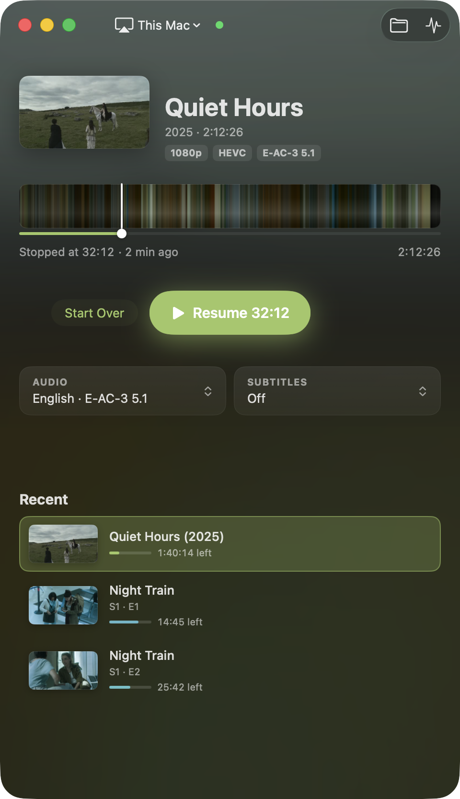

# How it works

[Back to the README](../README.md)

- [From a file to the TV](#from-a-file-to-the-tv)
- [Formats](#formats)
- [What gets converted](#what-gets-converted)
- [Finding the intro and the credits](#finding-the-intro-and-the-credits)
- [Syncing subtitles](#syncing-subtitles)
- [The colour timeline](#the-colour-timeline)
- [Staying connected](#staying-connected)
- [What leaves your Mac](#what-leaves-your-mac)
- [Why macOS warns about it](#why-macos-warns-about-it)

## From a file to the TV

The Apple TV can play HLS streams over AirPlay, but it won't open an MKV, among
other things. So Luftbro:

1. probes the file with ffprobe,
2. remuxes it into HLS (fragmented MP4 segments) with ffmpeg,
3. serves that from your Mac over HTTP,
4. and tells the Apple TV to play the URL, using [pyatv](https://pyatv.dev).

With fast start, segments are made as the TV asks for them, cut from the file's
keyframe index, so nothing waits for a full conversion. That's why an MKV, MP4
or MOV starts in about a second. Files that are still downloading
(`movie.mkv.part`) play as well, and Luftbro follows the file when the download
finishes.

Fast start needs the file's keyframe index, which MKV, WebM, MP4, M4V and MOV
files have. It doesn't apply to other formats, to files still downloading, or
when the video has to be re-encoded. Then playback waits for the start to be
prepared, the player says why, and the stream needs temporary disk space about
the size of the file.

A small Python backend does the work. The SwiftUI app starts it, talks to it
over localhost, and is the remote. The download has both, with their own Python
and ffmpeg. [`DESIGN.md`](DESIGN.md) describes the app and [`API.md`](API.md)
the API between the two.

## Formats

Luftbro opens MKV, MP4, M4V, MOV, WebM, AVI, TS and M2TS files, and also MPG /
MPEG, VOB, MTS / M2T (AVCHD from camcorders), WMV / ASF, FLV, OGV / OGM, 3GP,
DV, RM / RMVB and DIVX. They all work from Finder's *Open With*, the Open panel
and drag and drop. Downloads in progress (`.part`, `.crdownload`, `.!qB`,
`.!ut`) of any of these play too.

Only MKV, WebM, MP4, M4V and MOV get the one-second fast start; the rest are
prepared before playing. Either way, H.264 and HEVC video (in an MTS file from
a camcorder, say) is copied untouched, and anything else is converted with the
Mac's hardware encoder.

## What gets converted

Video and audio the Apple TV can play are copied as they are, so the quality is
untouched and it costs almost no CPU. The rest is converted while you watch.

| In the file | On the TV |
|---|---|
| H.264 / HEVC video | copied (HEVC tagged `hvc1`, Dolby Vision kept) |
| AV1, VP9, MPEG-2, … video | re-encoded with VideoToolbox (hardware) |
| AAC, AC-3, E-AC-3 (incl. Atmos) audio | copied |
| DTS, TrueHD, FLAC, Opus, … | E-AC-3 640k (surround) or AAC (stereo) |
| Text subtitles (SRT, ASS, WebVTT) | soft subtitles |
| Blu-ray picture subtitles (PGS) | read as text (OCR, about 10 s the first time per file, then cached), then soft subtitles |
| Other picture subtitles (VobSub, DVB) | burned into the picture, which means a video re-encode |

## Finding the intro and the credits

When a file has named chapters for the intro and the credits, Luftbro uses
them. When it doesn't, it looks. The intro is found by its sound: the same
theme repeats in the neighbouring episodes, so Luftbro matches the audio
against them. The credits are found in the picture, as a stretch of white text
on black near the end. When no credits turn up, the Up Next row shows in the
last two and a half minutes instead.

## Syncing subtitles

*Sync Automatically* works on text subtitles, and on picture subtitles that
have been read as text. Luftbro decodes three five-minute stretches of the
audio, spread over the film, and the sound classifier built into macOS says
every tenth of a second how sure it is that someone is speaking. The subtitles
are then slid over that, up to a minute either way, and the shift that puts the
most speech inside a subtitle wins. Each stretch of audio is also judged on
its own. When the three agree, one delay fits the whole film. When they
disagree, the subtitles drift: they run fast or slow, usually because they
were made for a release at another frame rate (PAL releases play film at 25
frames a second, 4 % faster than the 23.976 of most others). Then the subtitle
times are also scaled: by each frame-rate ratio, and by the amount a line
through the three measured shifts suggests, each refined until the three
agree. The best fit wins, taken as the frame-rate ratio it is within measuring
precision of, and a subtitle at time t is shown at t × scale + delay. A scale
more than 6 % away from 1 is refused, and so are subtitles that no single
scale and delay fit, as happens with subtitles for another cut of the film;
then nothing is changed. The result is kept for each file and pair of tracks,
so asking again doesn't mean listening again.

To show stretched subtitles, Luftbro writes a copy of them with every time
rewritten, the delay included (ffmpeg can shift a subtitle file, but not
stretch one): a subtitle file next to the video keeps its format, a text track
inside the file is extracted first, and picture subtitles are stretched once
they have been read as text. Subtitles burned into the picture can't be moved
at all.

## The colour timeline

When a file opens, Luftbro grabs a small frame every 10 seconds (keyframes only,
so a 45-minute episode takes a few seconds) and picks one colour for each frame.
Colourful pixels count for more than grey ones, so a scene keeps its hue instead
of averaging out to brown, and each colour is blended with its neighbours so
scenes show up as bands. Side by side, those colours are the timeline: you can
see the dark stretches, the daylight and the changes of scene before you jump.
The idea comes from [@movieluts](https://www.instagram.com/movieluts/).

The same frames set the window's look. The background is a blurred frame from
the film, with the current scene softly behind the title, and the accent colour
(progress, Resume) is the film's most vivid colour, adjusted to stay readable.
That's why every film looks a little different.

The picture next to the title is the file's cover art if it has one. Otherwise
it's the title card, found by reading the opening titles with the OCR built
into macOS, and failing that the best-lit, most colourful frame.

 

## Staying connected

The Apple TV fetches every segment from the Mac, and nobody touches the Mac
while watching, so left alone macOS would put it to sleep in the middle of a
film. While Luftbro streams it keeps the Mac awake. The display may still turn
off, and closing the lid still sleeps the Mac.

If the connection to the TV is lost anyway (the Wi-Fi drops, the lid closes),
Luftbro reconnects and carries on from where the TV was. It keeps trying for
about a minute before it gives up.

## What leaves your Mac

- The stream, to your Apple TV, on your own network.
- One request a day to GitHub, to see whether there's a newer release. You can
  turn it off in Settings.
- Nothing else. No account, no analytics. Nothing about you or what you watch
  is sent anywhere.

On the Mac itself, the backend's local API only answers requests that carry a
secret token made at each launch, so a web page or another program can't drive
it. Each stream's URL has a random secret path, and This Mac playback stays on
127.0.0.1. Watch history and the Apple TV pairing are kept in files only your
user account can read. The bundled Python ignores user site-packages and
Python environment variables such as `PYTHONHOME` and `PYTHONSTARTUP`.

## Why macOS warns about it

Apps from outside the App Store are normally signed with a paid Apple developer
certificate and notarized, meaning Apple scans them and vouches for who made
them. Luftbro is a free hobby project and has neither (notarizing costs $99 a
year), so macOS can't say who made it and warns, as it does about every app
like that. The warning doesn't mean anything was found in it.

You don't have to take that on trust:

- All of it is open source. Everything in the download is built from this
  repository by [`app/package-app.sh`](../app/package-app.sh): the SwiftUI app,
  the Python backend, ffmpeg compiled from its official source, Python from
  [python-build-standalone](https://github.com/astral-sh/python-build-standalone)
  (checksum-verified) and pyatv from PyPI.
- Upload the `.dmg` to [VirusTotal](https://www.virustotal.com), or check it
  with your own antivirus.
- Or [build it yourself](building.md) and don't use the download at all.
