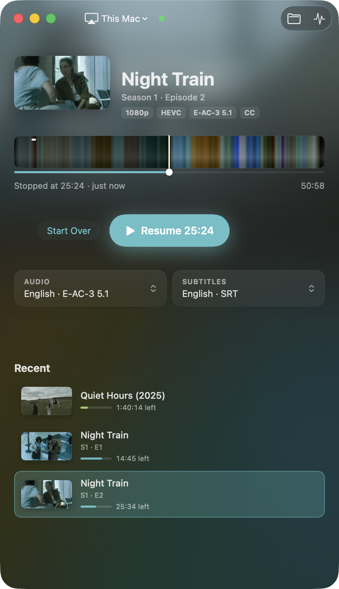
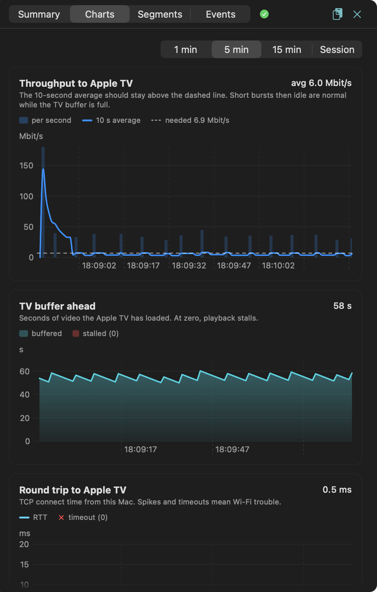

# Using Luftbro

[Back to the README](../README.md)

- [Opening a file](#opening-a-file)
- [Picking an Apple TV](#picking-an-apple-tv)
- [Keyboard shortcuts](#keyboard-shortcuts)
- [The timeline](#the-timeline)
- [Skip Intro and Next Episode](#skip-intro-and-next-episode)
- [Audio and subtitles](#audio-and-subtitles)
- [Sleep timer](#sleep-timer)
- [Volume, media keys and the Touch Bar](#volume-media-keys-and-the-touch-bar)
- [This Mac](#this-mac)
- [Diagnostics](#diagnostics)
- [Updates and settings](#updates-and-settings)

## Opening a file

Open a video by dropping it on the window, with ⌘O, or from the library. It
opens ready to play, with **Resume** and **Start Over** if you've watched part
of it, and nothing starts until you press Play. Double-click a file in the
library to start it straight away. Above the timeline you see what's playing
and its format: resolution, HDR, the video and audio codecs, CC when
subtitles are on, and Re-encode when the video has to be converted.

The library under the remote, *Recent*, holds the files you've played or
opened, with how far you got. For a series, Up Next suggests the next episode.
When an episode ends, the next one is loaded ready to play, and from the start
of the credits an Up Next row offers to play it. It never starts by itself.

When Luftbro has to prepare a file before it can play, the ready screen says
why (for instance "Video will be re-encoded"), with the details in a popover.

 

## Picking an Apple TV

The Apple TV picked in the menu at the top left is where everything plays,
whichever file you start, until you pick another. You can move playback to
another Apple TV in the middle of a film. If yours isn't listed, use *Scan for
Apple TVs* (⌘R) in that menu.

The first time you play to an Apple TV, it shows a PIN to type into Luftbro.

## Keyboard shortcuts

The same list is in the app under *Help → Keyboard Shortcuts* (⌘/).

**Playing**

| Keys | Action |
|---|---|
| Space | Play the file selected in the library, or pause / resume it if it's the one playing |
| ← / → | Back / forward 10 s (quick presses add up) |
| ⌘← / ⌘→ | Back / forward 30 s |
| ⌘↩ | Play / resume the loaded file |
| ⌘. | Stop |
| ⏭ (F9) · Space | Skip Intro / Next Episode (Space only while the button is new) |
| H / J | Subtitles half a second earlier / later (as in VLC; quick presses add up to one restart) |
| ⌘↑ / ⌘↓ | Volume: the TV's, or This Mac's |
| M | Mute / unmute This Mac |

**Library**

| Keys | Action |
|---|---|
| ↑ / ↓ | Previous / next file. While something plays they only move the highlight: Return plays it, Esc goes back |
| ⌥↑ / ⌥↓, Home / End | First / last file |
| Page Up / Page Down | Five files up / down |
| Return | Play the selected file |
| Tab / ⇧Tab | Move between the TV menu, the buttons, Audio, Subtitles and the library |
| Return · Esc | Use the button or open the menu Tab moved to · back to the library |

**This Mac window**

| Keys | Action |
|---|---|
| Double-click | Full screen (Esc leaves it) |
| Move the mouse | Show the controls |

**App**

| Keys | Action |
|---|---|
| ⌘O | Open a video |
| ⌘R | Scan for Apple TVs |
| ⌥⌘I | Show / hide Diagnostics |
| ⇧⌘C | Copy the Diagnostics report |
| ⌘/ | The list of shortcuts |

## The timeline

Hover the timeline to see a frame and its time; click or drag to jump. On the
ready screen a click starts playback at that point. The part you've watched is
dimmed. Thin bright marks along the top edge show where the intro and the end
credits are, and hovering there says "Intro" or "Credits".

[How the colours are chosen](how-it-works.md#the-colour-timeline).

## Skip Intro and Next Episode

A Skip Intro button shows during an episode's intro, and Next Episode when the
end credits start. Space presses the button for its first few seconds, ⏭ (F9,
or the media key) any time. Luftbro takes the intro and credits from the
file's chapters, or finds them itself when there are none
([how](how-it-works.md#finding-the-intro-and-the-credits)).

## Audio and subtitles

Change them from the two tiles, before or while playing. Playback restarts at
the same spot. The audio menu also has *Downmix to Stereo*.

Text subtitles work: SRT, ASS and WebVTT inside the file, and `.srt` files next
to the video or in a subfolder like `Eng/` or `Subs/`, also when they're named
by language only, as in `Subs/English.srt` or `Subs/SDH.eng.srt`. Blu-ray
picture subtitles (PGS) work too: they're read as text with the OCR built into
macOS, which takes about ten seconds the first time for each file.

If the subtitles are out of sync, **Subtitles → Delay** shifts them earlier or
later in half-second steps, in one pick, or use H / J. Each file keeps its
delay (and stretch, below) across launches.

**Subtitles → Delay → Sync Automatically** does it for you, which helps when the
subtitle file was made for another release of the film (a longer studio logo,
a cut intro, another frame rate). Luftbro listens to a few minutes of the audio
and moves the subtitles to where the speech is. A line under the tiles says
what it found, for example "Subtitles moved 2.4 s later". Subtitles that drift
further off as the film goes on, because they were made for a release at
another frame rate (25 fps for a 23.976 fps film, say), are stretched to fit as
well: "Subtitles stretched 4.3 % to fit (made for 25 fps)". The Delay menu
then shows the stretch on a line of its own; the delay choices and H / J still
move the subtitles earlier or later on top of it, and **Use the File's Timing**
puts them back as the file has them. If Luftbro isn't sure, or the subtitles
are for another cut of the film, it leaves them as they were and says so.

Each series remembers your audio language, subtitles and subtitle delay (and
stretch), so every episode starts the way you left the last one.

## Sleep timer

It's under the tiles while playing, or in *Playback → Sleep Timer*. Playback
stops after 15 minutes to 2 hours, and Resume picks up from there.

## Volume, media keys and the Touch Bar

⌘↑ / ⌘↓ change the TV's volume. That goes through the Apple TV, so it must be
set up to control your TV's volume (Apple TV Settings → Remotes and Devices →
Volume Control). *Playback → Mac Volume Keys Control the TV* makes the Mac's
own volume keys do it while Luftbro is in front; this needs the Accessibility
permission.

The media keys, Control Center and AirPods controls drive playback too.

On a MacBook Pro with a Touch Bar (set to show app controls), Luftbro fills it
with what's playing, −10 / play-pause / +30, Skip Intro / Next Episode and the
time, on a gradient in the film's colour.

## This Mac

Choose *This Mac* in the device menu to play in a window on the Mac. Move the
mouse to show the controls, which include the audio and subtitle menus and
*Picture & Sound*: brightness, contrast, saturation, Fit / Fill and volume.
M mutes, ⌘↑ / ⌘↓ change the volume. Double-click (or the button in the
controls) for full screen, Esc to leave it. Closing the window stops playback.

## Diagnostics

The button at the top right of the window, or ⌥⌘I. A coloured dot appears on
the button when something is wrong. The panel slides out from beneath the
window when the screen has room beside it, and the window itself never moves
or changes size. Otherwise, and in full screen, it opens under the remote.

- **Summary** names the likely cause of a problem (network, encoder, Apple TV,
  source file or Luftbro's own server), with the evidence, and shows the
  numbers that matter: throughput, the TV's buffer, round trip, stalls.
- **Charts** shows the same over time.
- **Segments** lists every piece of the stream the TV asked for and how fast it
  went.
- **Events** is the log.

It records all the time, so you can open it after something went wrong.
*Copy Report* (⇧⌘C) gives a plain-text summary to paste into an
[issue](https://github.com/luftbro/luftbro/issues).

 

## Updates and settings

The downloaded app checks GitHub for a newer release once a day. When there is
one, a line above Recent says so. Luftbro only offers a release signed with
its maintainer's key, which isn't kept on GitHub. **Install** downloads it,
checks it against the signed checksum, quits Luftbro, replaces it and opens
the new one.
Nothing installs without that click. **Luftbro → Check for Updates…** checks
right away. For this to work Luftbro has to be in a folder it can write to,
like Applications. macOS may ask once whether Luftbro may modify apps; allow it.

Settings has two switches: the daily update check, and *Show Diagnostics
automatically when playback fails* (off unless you turn it on).
